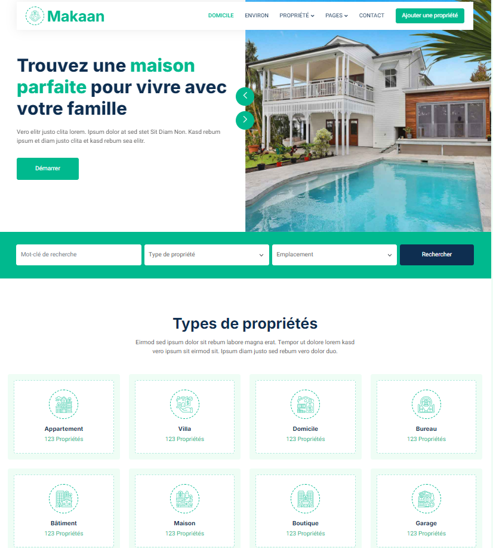
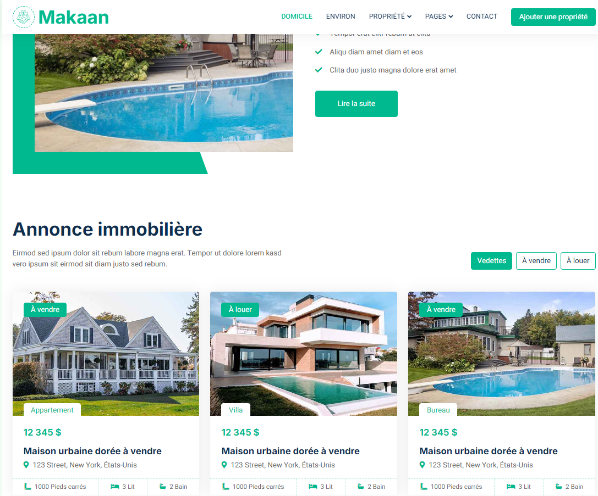
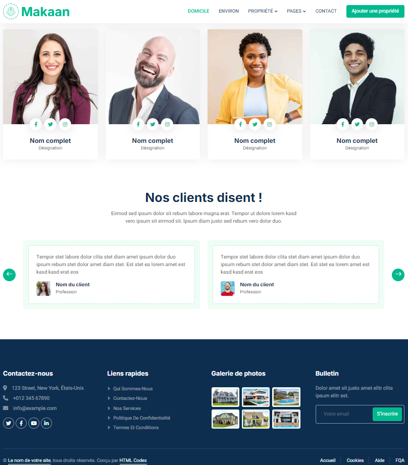
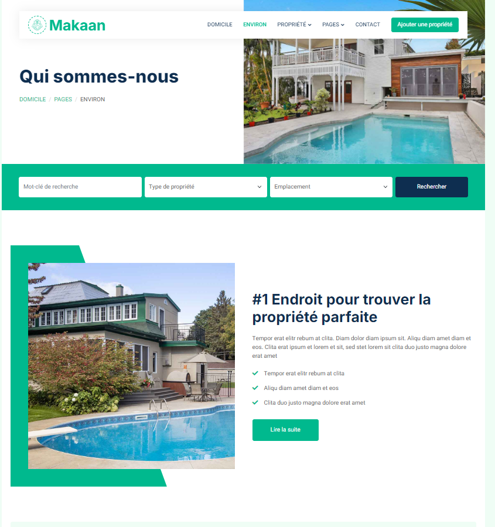
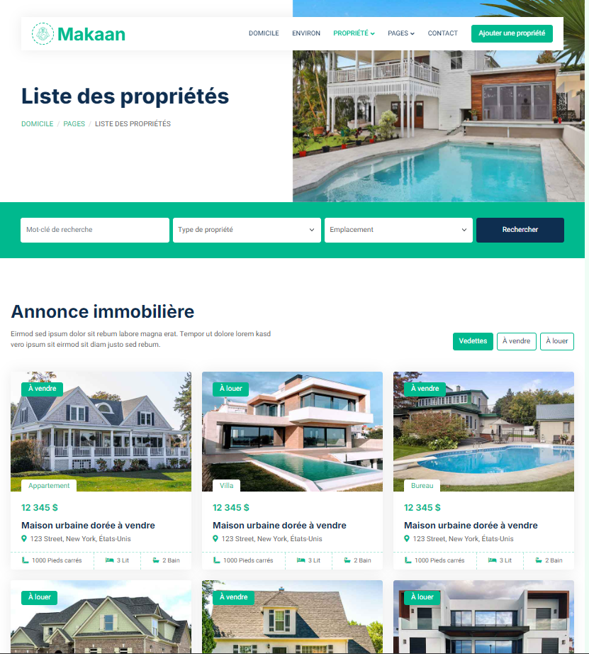
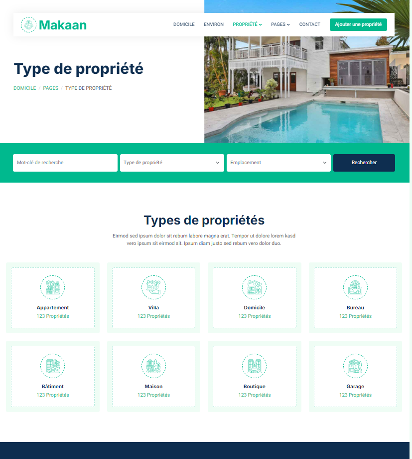
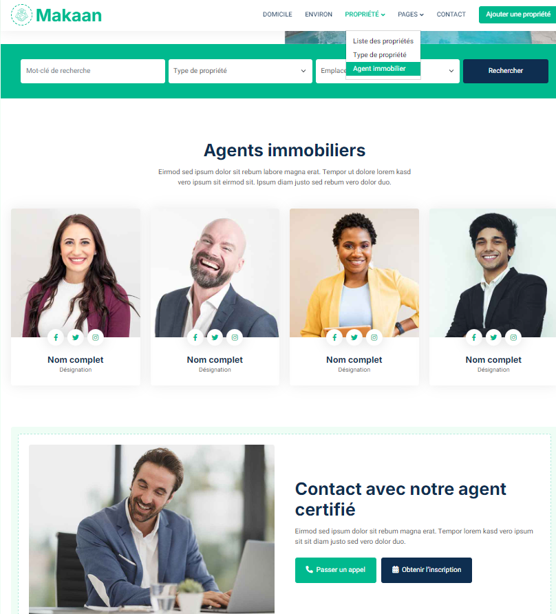
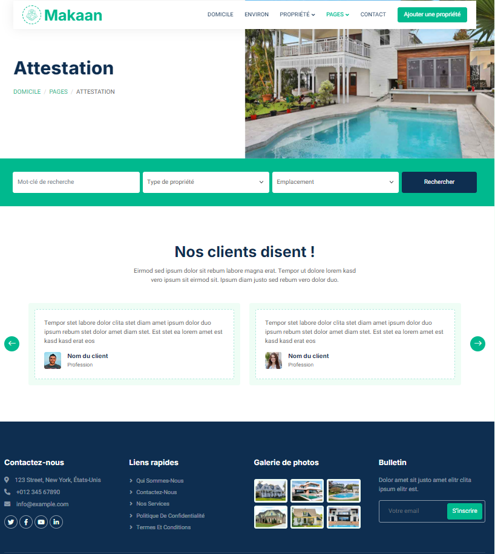
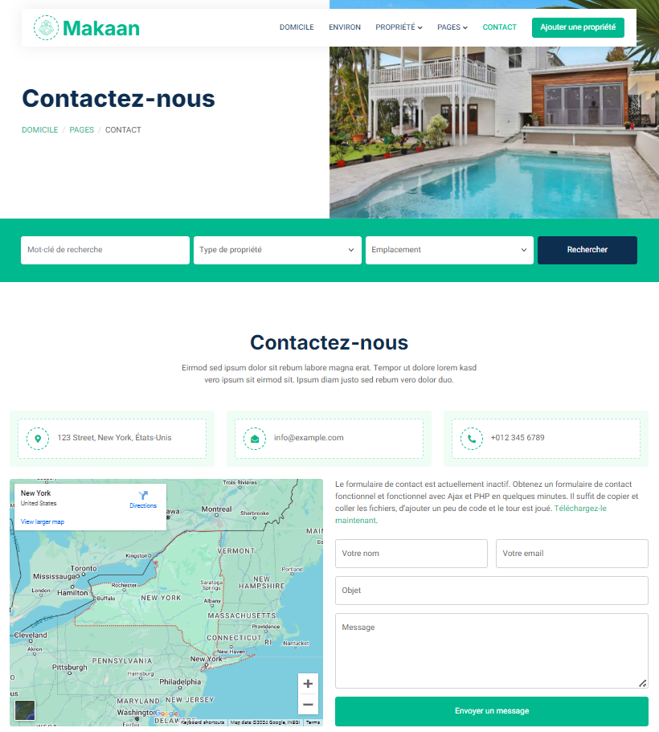
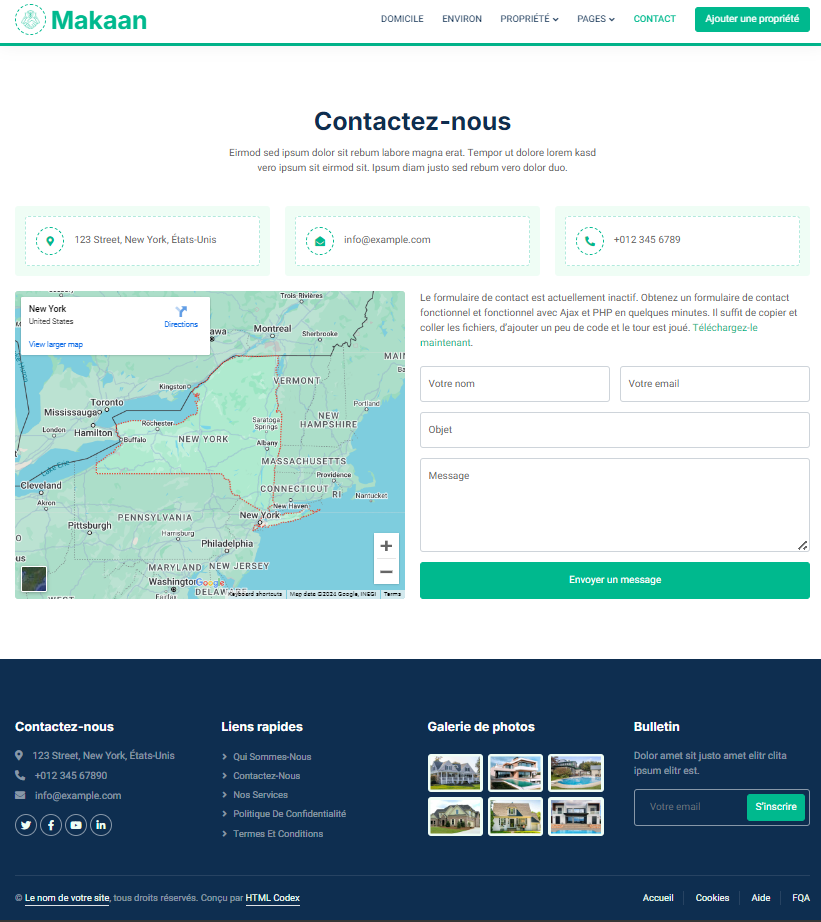

# project-hotel-manager
project-hotel-manager

==================================   # DOCUMENTATION     ================================

1-Architecture hexagonale;
2-Front et Back fait avec Next JS;
3-Mongo DB;
4-Mobile react native;
















## Lancer PleasantStay avec Docker

Pile complète décrite dans `docker-compose.yml` (secrets dans `.env`, modèle `.env.example`) :

| Service | URL locale | Rôle |
|---|---|---|
| `api` | http://localhost:3002/api (Swagger : `/api/docs`) | API NestJS |
| `backoffice` | http://localhost:3006 | Back-office ERP |
| `frontoffice` | http://localhost:3007 | Site public |
| `mobile` | http://localhost:3008 | Application mobile (web) |
| `mongo` | `localhost:27017` (authentification obligatoire) | MongoDB 7 |

```bash
cp .env.example .env                    # première fois : renseigner les secrets
docker compose up -d --build            # construire et démarrer
docker compose run --rm api node dist/scripts/seed.js   # base vide : initialisation
docker compose logs -f api              # journaux
docker compose down                     # arrêter (les données restent dans le volume)
```

- MongoDB Compass : `mongodb://<MONGO_ROOT_USERNAME>:<MONGO_ROOT_PASSWORD>@localhost:27017/?authSource=admin` (valeurs dans `.env`).
- L'API utilise un compte limité à `bd_pleasantstay` (`MONGO_APP_USERNAME`), créé au premier démarrage par `docker/mongo-init/`.
- Développement de l'API sans Docker : `project-hotels-manager-backend/.env` (port 3005), même base.
- Si `registry.npmjs.org` est inaccessible, définir `NPM_REGISTRY` dans `.env` (miroir) : les empreintes du `package-lock.json` restent vérifiées.

## Comptes de démonstration

Créés par `npm run seed` (ou `docker compose run --rm api node dist/scripts/seed.js`),
sauf si `SEED_DEMO=false`. Mots de passe connus : **à réserver aux
environnements de test**, à changer ou désactiver en production.

| Profil | E-mail | Mot de passe | Type de compte (connexion) | Rôle | Accès principaux |
|---|---|---|---|---|---|
| Super administrateur | admin@pleasantstay.local | généré au premier seed (affiché une fois) | super_admin | super_admin | Tout |
| Propriétaire | proprietaire@pleasantstay.local | Proprio@2026 | owner | owner | Tout ; installe les applications, modifie l'apparence |
| Directeur d'hôtel | directeur@pleasantstay.local | Directeur@2026 | receptionist | manager | Hôtel, réservations, facturation et toutes les applications ERP |
| Réceptionniste | reception@pleasantstay.local | Reception@2026 | receptionist | receptionist | Réservations, clients, factures, encaissements, caisse ; CRM et fidélité en lecture |
| Gouvernante | gouvernance@pleasantstay.local | Menage@2026 | housekeeping | housekeeping | Ménage, maintenance, chambres ; stock en lecture |
| Comptable | comptable@pleasantstay.local | Comptable@2026 | accountant | accountant | Comptabilité, factures, paiements, factures fournisseurs ; achats en lecture |
| Client | client@pleasantstay.local | Client@2026 | guest | guest | Espace client uniquement |

Les comptes du personnel sont rattachés à l'hôtel de démonstration PS-ABJ.
Les permissions de chaque rôle sont définies dans
`project-hotels-manager-backend/src/scripts/seed.ts` (`ROLES`).

## Apparence du back-office

Menu **Apparence** (`/admin/appearance`, super-admin ou propriétaire) :
couleurs (principale, survol, texte, fonds, barre latérale, en-tête,
dégradé de la page de connexion), nom, sous-titre et logo, arrondi, taille
du texte, barre latérale repliée par défaut. Aperçu immédiat, enregistrement
pour tous les utilisateurs via `PATCH /api/site-config/theme`.
